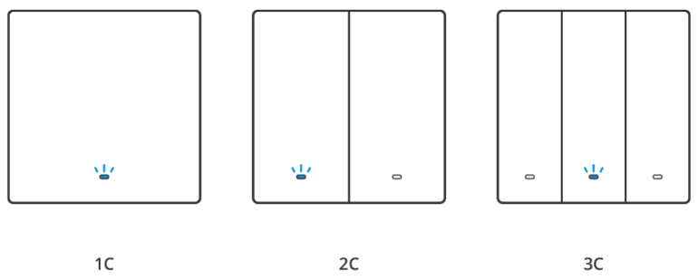
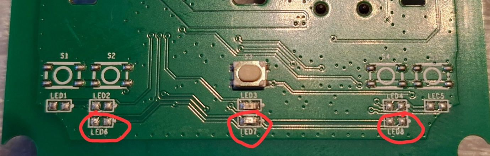
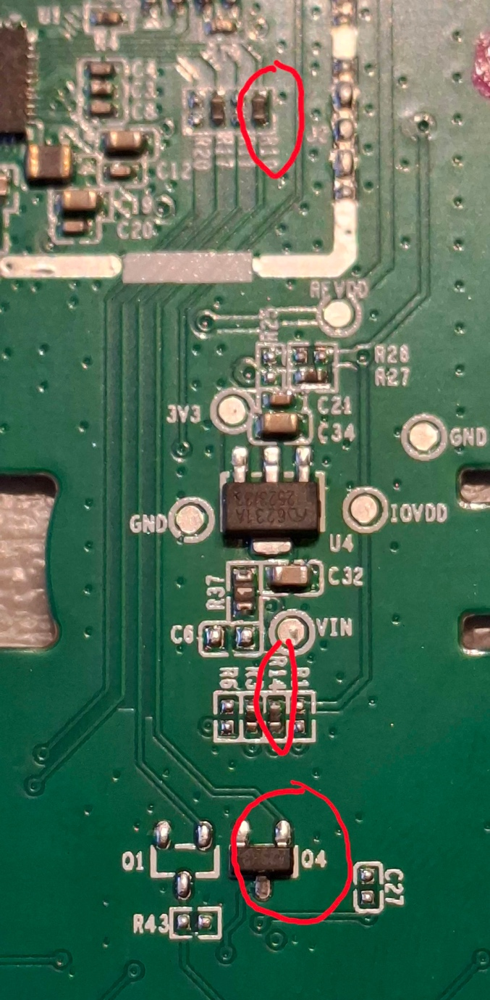
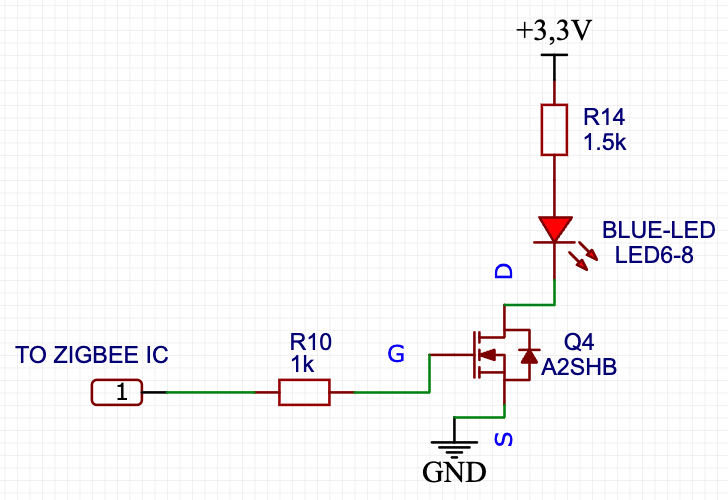
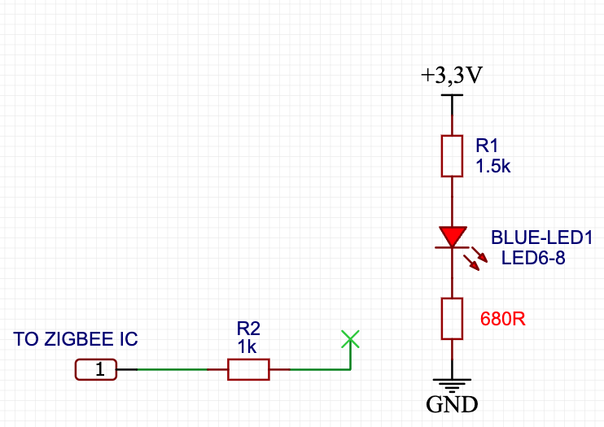
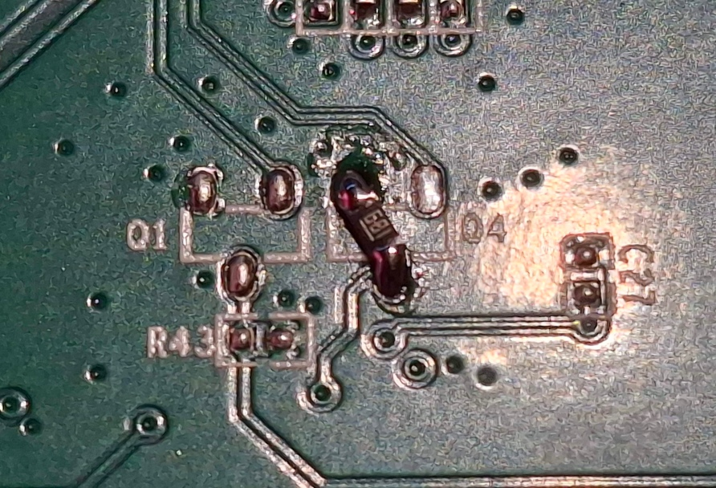
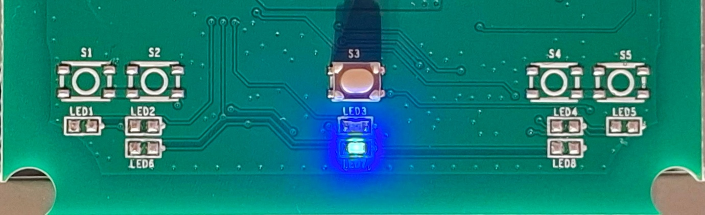

# SONOFF ZBM5-1C-86W: Always-On Blue LED Modification

> **Warning — mains-powered equipment.** This modification requires opening and soldering a mains-powered wall switch. Disconnect it completely from mains power before opening it. Do not work on the device while it is connected to mains. This modification is at your own risk and may damage the device, affect its warranty, and compromise its safety if performed incorrectly.

A simple hardware modification for the SONOFF ZBM5 Zigbee smart wall switch (1-, 2- and 3-gang versions) that makes its blue LED stay on continuously.

I created and tested this modification on my own devices.

In SONOFF ZBM5 switches, the position of the blue LED depends on the number of gangs the switch has (LEDs 6–8). There is a single blue LED in each unit, and it is driven by the same circuit.

The blue LED is driven through this path:

`Zigbee IC GPIO → R10 (1 kΩ) → Q4 (A2SHB MOSFET) → blue LED → R14 (1.5 kΩ) → +3.3 V`

## What this modification does?

In the original circuit, Q4 (an A2SHB MOSFET) is controlled by the Zigbee IC and switches the blue LED on and off. I developed and tested a simple hardware modification: I removed Q4 and replaced it with a **680 Ω resistor** connected between the LED's cathode and GND. This creates a permanent current path, keeping the blue LED continuously illuminated.

### This modification disables the blue LED's Zigbee network-indicator function. The LED stays on permanently and no longer indicates the Zigbee network status.

## Parts and tools:

- 680 Ω resistor (for the always-on blue LED modification)
- Soldering tools suitable for small SMD components
- Magnification and suitable ESD precautions

The board also has an existing R14 current-limiting resistor marked as 1.5 kΩ.

## Procedure:

1. Disconnect the switch completely from mains power and remove it from its installation.
2. Open the enclosure carefully.
3. Locate Q4, marked **A2SHB**, in the blue-LED driver circuit. The blue LED's physical position differs between 1-, 2- and 3-gang versions; consult the photos and trace the circuit rather than relying only on the LED reference number.
4. Remove Q4.
5. Solder a **680 Ω resistor in the place of Q4**, connecting the LED's switched-side pad to GND as shown in the modified schematic.
6. Inspect the soldering carefully for bridges, lifted pads and unintended connections before reassembly.
7. Reassemble the switch fully before reconnecting it to mains power.

And the result:

## Adding an extra indicator LED on multi-gang versions:

For multi-gang versions, an additional LED can be installed under a button, if desired. The LED with approximately **2.5 V forward voltage at 5 mA**. In this arrangement, the additional 680 Ω resistor may be omitted.
Verify the LED polarity and current path for your particular board before making this change.

## Scope and limitations:

- This is a hardware modification, not a Zigbee2MQTT or Home Assistant software setting.
- The network-indicator function is sacrificed.
- Board layouts and blue-LED placement can vary between versions.
- The component values and procedure reflect the author's documented build; they are not a manufacturer-approved modification.

## Contributions:

If you test this on another ZBM5 variant, please share the exact model/board revision, clear photos before and after modification, and the measured result.
